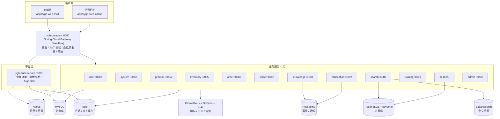

# 粤港甄选跨境智汇 AI 知识库系统

> A cross-border e-commerce microservice backend, combining the trading domain (order / wallet / product / inventory) with an AI customer-service and enterprise knowledge-base stack.

[](https://openjdk.org/projects/jdk/25/)
[](https://spring.io/projects/spring-boot)
[](https://spring.io/projects/spring-cloud)
[](https://maven.apache.org/)
[](https://github.com/zhyidev/yuegang-zhihui-ai/actions/workflows/backend-quality.yml)

粤港甄选是一套面向粤港跨境电商场景的分布式后端系统：**跨境电商交易链路**（用户、商品、库存、订单、钱包）与 **AI 客服 + 企业知识库**（文档入库、混合检索、大模型编排）跑在同一套微服务体系里，所有外部流量统一经网关进入。

- **14 个 Java 服务**：网关 + 认证 + 12 个业务服务
- **7 个公共库**：统一响应、安全、Redis、MyBatis、消息、Web、测试基础设施
- **独立前端工作区**：商城端与管理后台（Vue 3 + pnpm workspace）
- **工程化底线**：Flyway 仅向前迁移策略、JaCoCo 覆盖率门禁、Trivy 依赖与配置扫描、CycloneDX SBOM

---

## 目录

- [系统架构](#系统架构)
- [核心能力](#核心能力)
- [服务清单](#服务清单)
- [技术栈](#技术栈)
- [模块结构](#模块结构)
- [快速开始](#快速开始)
- [开发规范](#开发规范)
- [质量门禁与 CI](#质量门禁与-ci)
- [Spring Boot 4 注意事项](#spring-boot-4-注意事项)
- [文档索引](#文档索引)
- [项目状态](#项目状态)

---

## 系统架构



**请求路径**：浏览器 → 网关（验签、会话校验、注入用户上下文）→ 目标服务（`lb://` 经 Nacos 负载均衡）。前端不直连业务服务端口。

---

## 核心能力

### 1. 统一网关与安全入口
- Spring Cloud Gateway（WebFlux 响应式）：路由、限流、CORS、请求体大小限制与上传路径白名单
- OAuth2 Resource Server + JWT（RS256）：`iss` / `exp` / `aud` 校验，Claims 到内部主体的安全映射
- 会话撤销：JWT 黑名单存 Redis，网关过滤器查黑名单实现即时登出
- 链路追踪：`CorrelationIdFilter` 生成并回写链路 ID
- 统一错误响应：`GatewaySecurityErrorWriter` 输出统一 JSON 错误格式

### 2. 认证与账号安全
- Argon2id 密码哈希（BouncyCastle，PHC 编码格式），恒定时间比较防时序攻击
- 令牌签发与刷新、RBAC 权限模型（角色 / 权限 / 审计）
- 内部服务调用签名校验，防止绕过网关直连

### 3. 字段级加密
- 收货地址等 PII 字段 AES-256-GCM 加密入库，AAD 绑定 `userId:field:keyVersion`，防密文挪用
- 供应商 API Key 加密存储；系统设置中的敏感值只落 SHA-256 摘要

### 4. 分布式锁与会话管理
- Redis 分布式锁防重复提交，会话状态与撤销列表集中管理
- Key 命名强制规范（见[开发规范](#开发规范)），同一用户的 Key 带 Hash Tag 落在同一 slot

### 5. 数据库迁移安全
- Flyway「仅向前」策略：只允许 `V<正整数>_<snake_case>.sql`，禁止 Undo / Repeatable / Java 迁移
- 启动前校验命名、版本单调递增与路径安全，不合规直接拦截启动
- 当前 46 个迁移脚本覆盖全部服务

### 6. AI 应用层（`ygh-ai-service`）
- **模型网关抽象**：`ModelGateway` 统一接口，支持供应商动态配置、可用性熔断（`UnavailableModelGateway`）与调用耗时度量
- **检索网关抽象**：`RetrievalGateway` 统一检索入口，支持治理与度量装饰
- **对话编排**（`ChatService`）：会话上下文、引用溯源（`CitationView`）、用户反馈闭环
- **工具调用**：`CommerceToolGateway` 将业务侧只读能力暴露给模型
- **AI 评估**：评估用例、评估运行与治理（`AiEvaluationService` + `AiGovernanceService`）

### 7. 混合检索（`ygh-search-service`）
- `HybridSearchService`：Elasticsearch 关键词召回与 pgvector 向量召回并行执行，按 **RRF（`1 / (60 + rank)`）** 融合排名后重排
- 向量维度 1024，索引与分块写入由 `index(IndexChunkCommand)` 管理，支持索引重建与文档版本

### 8. 知识库流水线（`ygh-knowledge-service`）
- 文档上传 → 解析分发（`KnowledgeParseDispatcher`）→ 索引分发（`KnowledgeIndexDispatcher`）→ 生命周期与过期清理（`KnowledgeExpiryJob`）
- 处理任务持久化 + Outbox 事件投递，任务可恢复；节点级状态可查询

### 9. 消息可靠性
- RocketMQ 统一封装（`ygh-common-mq`）：重试、死信、幂等消费
- 通知服务基于事件驱动，发送链路可审计

### 10. 可观测性
- Micrometer 指标 + Prometheus 采集，Grafana 看板，Loki + Promtail 日志
- 告警覆盖服务不可用、HTTP 错误率、P95 延迟、JVM 堆、数据库连接池与磁盘水位

---

## 服务清单

| # | 服务 | 端口 | 职责 |
|---|------|------|------|
| 1 | `ygh-gateway` | 8080 | 路由、JWT 校验、会话黑名单、限流、统一错误响应 |
| 2 | `ygh-auth-service` | 8081 | 登录注册、令牌签发、密码安全 |
| 3 | `ygh-user-service` | 8082 | 用户资料、收货地址（加密存储）、部门组织架构 |
| 4 | `ygh-system-service` | 8083 | 角色权限、字典、Feature Flag、AI 供应商配置 |
| 5 | `ygh-product-service` | 8084 | SPU/SKU、分类品牌、批次溯源、缓存与搜索分发 |
| 6 | `ygh-inventory-service` | 8085 | 库存调整、预占、确认、释放，防超卖 |
| 7 | `ygh-order-service` | 8086 | 购物车、下单（服务端快照）、订单超时关闭 |
| 8 | `ygh-wallet-service` | 8087 | 充值、支付、退款，防透支 |
| 9 | `ygh-knowledge-service` | 8088 | 文档上传解析、分块、审核、索引分发 |
| 10 | `ygh-search-service` | 8089 | 混合检索（ES + pgvector）、索引生命周期 |
| 11 | `ygh-ai-service` | 8090 | 大模型网关、对话编排、RAG 检索、AI 评估 |
| 12 | `ygh-training-service` | 8091 | 任务分配、学习进度、测验 |
| 13 | `ygh-notification-service` | 8092 | 通知模板、发送、死信、审计 |
| 14 | `ygh-admin-service` | 8093 | 仪表盘聚合、审计日志查询 |

> 端口均支持环境变量覆盖（如 `YGH_USER_PORT`）。

---

## 技术栈

| 分类 | 组件 | 版本 |
|------|------|------|
| 语言 / 运行时 | Java | 25 |
| 框架 | Spring Boot | 4.0.7 |
| 微服务 | Spring Cloud / Spring Cloud Alibaba | 2025.1.2 / 2025.1.0.0 |
| 网关 | Spring Cloud Gateway（WebFlux 响应式） | — |
| 注册与配置 | Nacos | — |
| 持久层 | MyBatis-Plus（`mybatis-plus-spring-boot4-starter`） | 3.5.16 |
| 关系库 | MySQL（业务库）/ PostgreSQL + pgvector（向量库） | pgvector 0.8.5 (pg17) |
| 检索 | Elasticsearch（关键词召回） | — |
| 缓存 / 锁 | Redis | — |
| 消息 | RocketMQ | — |
| 迁移 | Flyway（仅向前策略） | — |
| AI | LangChain4j、大模型供应商网关 | — |
| 文档 | Springdoc OpenAPI | 3.0.3 |
| 前端 | Vue 3 + TypeScript + Vite + pnpm workspace | — |
| 可观测性 | Micrometer、Prometheus、Grafana、Loki、Promtail、Alertmanager | — |
| 构建 | Maven（enforcer 强制 3.9.16 ~ 4.0.0）、JaCoCo 0.8.15、CycloneDX SBOM | — |

---

## 模块结构

```text
yuegang-zhihui-ai/
├── ygh-dependencies/            # BOM：统一声明所有第三方版本
├── ygh-common/                  # 公共基础层（7 个库）
│   ├── ygh-common-core/         #   ApiResponse / ErrorCode / PageRequest / PageResponse
│   ├── ygh-common-security/     #   会话撤销存储 / 权限注解 / 内部服务签名
│   ├── ygh-common-redis/        #   Key 规范、分布式锁、会话状态（自动配置）
│   ├── ygh-common-mybatis/      #   Flyway 迁移策略 / MyBatis-Plus 分页适配
│   ├── ygh-common-mq/           #   消息封装：重试 / 死信 / 幂等
│   ├── ygh-common-web/          #   Web 公共组件
│   └── ygh-common-test/         #   测试基础设施（Testcontainers 夹具）
├── ygh-platform/                # 平台层
│   ├── ygh-gateway/             #   Spring Cloud Gateway（黑名单 / 统一错误 / 链路 ID）
│   └── ygh-auth-service/        #   认证：Argon2id / 令牌签发 / RBAC
├── ygh-applications/            # 12 个业务服务
│   ├── ygh-user/  ygh-system/  ygh-product/  ygh-inventory/
│   ├── ygh-order/ ygh-wallet/  ygh-knowledge/ ygh-search/
│   ├── ygh-ai/    ygh-training/ ygh-notification/ ygh-admin/
├── ygh-tests/                   # 集成 / E2E / 安全 / 契约（API 兼容）测试
├── ygh-deploy/                  # 部署配置
│   ├── constrained-dev/         #   资源受限开发环境 Compose 参考
│   ├── enterprise-server/       #   企业服务器全量 Compose 参考
│   ├── observability/           #   Prometheus / Loki / Promtail / Alertmanager 配置
│   └── nacos/                   #   Nacos 配置参考
├── ygh-web/                     # 前端工作区（pnpm）
│   ├── apps/ygh-web-mall/       #   商城端：商城、知识中心、AI 客服、个人中心、培训
│   ├── apps/ygh-web-admin/      #   运营后台：商品 / 订单 / 知识 / 培训 / RBAC / 审计
│   └── packages/ygh-web-shared/ #   统一响应、JWT 会话、权限、Axios Client、SSE
├── spec/                        # 接口契约与交付规格
│   ├── openapi/                 #   各服务 OpenAPI 描述
│   ├── bruno/                   #   Bruno 接口集合
│   ├── backend-delivery.md      #   后端交付说明
│   └── environment-deployment.md#   环境与部署说明
├── tools/local-runner/          # 本地多服务启动器（读取扁平 YAML 注入环境变量）
├── docs/                        # 项目详解与技术清单
└── .github/workflows/           # CI：backend-quality
```

---

## 快速开始

### 前置要求

| 依赖 | 版本 | 说明 |
|------|------|------|
| JDK | 25 | 根 `pom.xml` 通过 enforcer 强制 `[25, 26)` |
| Maven | 3.9.16 ~ 3.9.x | 低于 3.9.16 会被 enforcer 拦截 |
| Docker + Compose | 最新稳定版 | 基础设施与编排校验 |
| Node.js + pnpm | 18+ / 9+ | 仅前端工作区需要 |

### 1. 构建

```bash
export JAVA_HOME=/path/to/jdk-25
export PATH=$JAVA_HOME/bin:$PATH

# 全量验证（编译 + 单元测试 + 集成测试 + 覆盖率门禁）
mvn --batch-mode clean verify

# 只编译某个服务（含依赖模块）
mvn -pl ygh-applications/ygh-ai/ygh-ai-service -am compile
```

### 2. 启动基础设施

部署配置分两类，按环境选择：

```bash
# 资源受限开发环境（本机联调，按需启动组件）
docker compose -f ygh-deploy/constrained-dev/vm-compose.yml up -d

# 企业服务器参考编排（MySQL / Redis / Nacos / RocketMQ / pgvector / ES / 监控）
docker compose -f ygh-deploy/enterprise-server/compose.yml config --quiet
```

> 编排文件仅作配置参考，**不提供一键部署脚本**。生产环境的数据库与账号需按部署文档逐项创建、授权并验证；MySQL、Redis、Elasticsearch、RocketMQ、Nacos 应替换为高可用集群或云托管服务；镜像必须使用不可变版本或 digest，禁止 `latest`。

### 3. 注入环境变量

服务通过环境变量读取连接信息与密钥，仓库内**不保存任何真实凭据**：

```bash
export YGH_GATEWAY_PORT=8080
export YGH_AUTH_DB_APP_USERNAME=<your-user>
export YGH_AUTH_DB_APP_PASSWORD=<your-password>
export YGH_NACOS_USERNAME=<your-user>
export YGH_REDIS_HOST=<your-host>
export YGH_REDIS_PASSWORD=<your-password>
# 其余变量见各服务 resources/application.yml
```

本地联调可使用启动器读取扁平 YAML（示例：`tools/local-runner/ygh-core-services.yaml.example`）：

```bash
java -cp tools/local-runner/target/classes com.yuegang.zhihui.tools.LocalServiceLauncher \
  --env /path/outside/repo/ygh-core-services.yaml --check
```

> 含真实密钥的配置文件必须放在仓库之外，并确保已被 `.gitignore` 忽略。

### 4. 启动服务

先启动 Nacos，再启动 `ygh-gateway`，然后按需启动业务服务（服务启动时会注册到 Nacos）：

```bash
mvn -pl ygh-platform/ygh-gateway spring-boot:run
mvn -pl ygh-applications/ygh-ai/ygh-ai-service spring-boot:run
```

验证：`http://localhost:8080/actuator/health`；接口文档：各服务 `/swagger-ui.html`（或 `/v3/api-docs`）。

### 5. 前端工作区

```bash
cd ygh-web
pnpm install
pnpm dev:mall     # 商城端
pnpm dev:admin    # 运营后台
pnpm type-check && pnpm build
```

---

## 开发规范

### 数据库迁移（Flyway 仅向前）

```text
命名：db/migration/V<正整数>_<lower_snake_case>.sql   例：V1__create_user_table.sql
禁止：Undo（U 前缀）、Repeatable（R__ 前缀）、Java 迁移
约束：版本号单调递增；禁止 ../ 路径穿越
```

`FlywayMigrationPolicy` + `YghFlywayMigrationStrategy` 在启动前完成校验，不合规直接阻断启动。

### Redis Key 规范

```text
ygh{environment}:{service}:{business}:{identifier}
示例：yghdev:auth:session:user123
```

- 固定 5 段、冒号分隔，首段固定 `ygh`
- `environment` / `service` / `business` 小写字母数字开头，允许中划线，≤32 字符
- `identifier` 字母数字开头，允许 `._-`，≤128 字符
- 同一用户的会话 Key 带 `{accountId}` Hash Tag，保证落在同一 Redis slot

### 编码约定

- record 用于不可变 DTO / 值对象；构造器注入优先，不用字段注入
- 禁用 `System.out`，统一 SLF4J；错误码集中定义并返回统一响应体
- 自动配置类必须注册到 `META-INF/spring/org.springframework.boot.autoconfigure.AutoConfiguration.imports`

### 提交规范

```text
type(模块): 简述
```

`type` ∈ `feat` / `fix` / `refactor` / `docs` / `chore` / `test`。

---

## 质量门禁与 CI

CI 工作流 `.github/workflows/backend-quality.yml` 在 push 到 `main` 与 PR 时执行：

1. `mvn clean verify` —— 编译、单元测试、集成测试，并执行 JaCoCo 覆盖率门禁
2. 生成 CycloneDX SBOM
3. Trivy 扫描依赖与配置（`vuln,misconfig,secret,license`，仅 HIGH/CRITICAL 阻断）
4. 上传 Surefire / Failsafe 报告与 JaCoCo 覆盖率报告
5. 校验 `ygh-deploy/enterprise-server/compose.yml` 编排文件合法性

覆盖率门槛（根 `pom.xml`）：

| 范围 | 行覆盖 | 分支覆盖 |
|------|--------|----------|
| 默认 | ≥ 70% | ≥ 60% |
| `ygh-gateway` | ≥ 70% | ≥ 90% |

---

## Spring Boot 4 注意事项

### Jackson 3 包名迁移

Spring Boot 4 升级至 Jackson 3，`databind` / `core` 的包名由 `com.fasterxml.jackson` 变为 `tools.jackson`：

```java
// ❌ 旧（Spring Boot 3.x / Jackson 2.x）
import com.fasterxml.jackson.databind.ObjectMapper;

// ✅ 新（Spring Boot 4.x / Jackson 3.x）
import tools.jackson.databind.ObjectMapper;
```

`jackson-annotations` 仍在 `com.fasterxml.jackson.core` 下。

### 自动配置注册

Spring Boot 4 通过 `AutoConfiguration.imports` 注册自动配置类，`@AutoConfiguration` 类必须在此文件登记才会被扫描。

### 常见问题

| 症状 | 原因 | 解决 |
|------|------|------|
| `No beans of 'ObjectMapper' type found` | 引用了 `com.fasterxml.jackson` 旧包名 | 改为 `tools.jackson.databind.ObjectMapper` |
| `No beans of 'XxxWriter' type found` | 类未注册为 Bean | 补 `@Component` 或 `@Bean` |
| `No beans of 'ReactiveSessionValidator' type found` | `@ConditionalOnBean` 条件不满足 | 确认依赖链上存在响应式 Redis |
| enforcer 报 Maven 版本错误 | 系统 Maven 低于 3.9.16 | 使用 3.9.16+ |
| enforcer 报 Java 版本错误 | 默认 JDK 低于 25 | 设置 `JAVA_HOME` 指向 JDK 25 |

---

## 文档索引

| 文档 | 内容 |
|------|------|
| `docs/粤港甄选AI知识库系统-零基础完全详解.md` | 从启动到各模块的全景详解 |
| `docs/技术清单.md` | 逐文件整理的技术点清单（含源文件定位） |
| `spec/backend-delivery.md` | 后端交付说明 |
| `spec/environment-deployment.md` | 环境与部署说明 |
| `spec/openapi/` | 各服务 OpenAPI 描述 |
| `spec/bruno/` | Bruno 接口调试集合 |
| `ygh-deploy/*/README.md` | 部署配置参考与注意事项 |
| `AGENTS.md` | 协作与构建约定（模块结构、约定、排错） |

---

## 项目状态

- 14 个 Java 服务在 `main` 分支已完成落地，集成测试、E2E、安全与 API 兼容测试覆盖主要链路
- 部署配置面向两类环境：资源受限开发环境（本机联调）与企业服务器参考编排（生产需替换为高可用组件）
- 前端工作区已从设计原型重构为正式 Vue 3 工程，商城端与管理后台共享会话与请求层

### Roadmap

- [ ] 网关与业务服务的全链路压测与容量评估
- [ ] 检索质量评估集与回归指标（召回率 / 引用准确率）
- [ ] 大模型供应商灰度与成本看板
- [ ] 前端工作区的端到端测试接入 CI

---

## License

本项目暂未声明开源许可证，如需转载或使用请联系作者。
